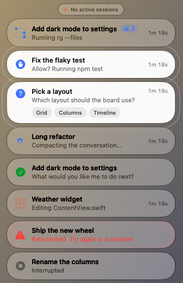
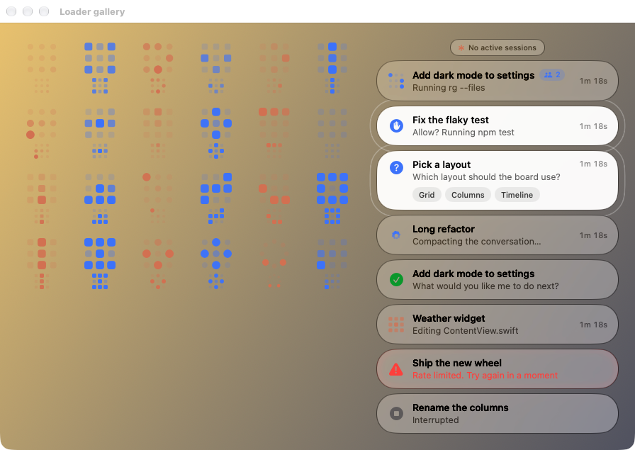

# Claude Pill

A floating Liquid Glass status pill for Claude Code and Codex. Drag it anywhere; it shows every
active session (desktop app or terminal) and what each one is doing right now. Claude sessions
use Claude's orange, Codex sessions use Codex blue. It also takes screenshots and screen
recordings (this used to be a separate app, Snappabl), and everything that happens shows up in
one place: the island above the pills.

<p align="center"></p>

| State | Looks like | Shown when |
| --- | --- | --- |
| Working | grid, dot or ring loader + timer | after a prompt, while tools run ("Running npm test", "Editing App.swift") |
| Compacting | ring of dots squeezing in | the conversation is being summarized |
| Needs you | white pill with rippling rings | permission (hand), a question with its options (?), a plan to review, a tool asking for input, or a reply ending in a question |
| Error | red triangle, red-tinted glass | the turn died: rate limit, overload, sign-out, usage limit, API error… |
| Done | green disc, see-through check | Claude finished; shows the last line of its reply |
| Interrupted | grey stop | you stopped the turn |
| Quiet | grey pause | busy but nothing has happened for 5+ minutes |

While working, a failed command or a denied permission shows in red in place of the
status line, and a badge counts the sub-agents running. Clicking a finished or
interrupted pill opens the session and clears the pill.

Drag the stack anywhere. In the top half of the screen it hangs from its top edge; drop it in
the bottom half and it sits on its bottom edge and grows upward, most urgent pill nearest the edge.

The working loader is a 3×3 grid of rounded rectangles or dots, or a ring of 8 dots, lighting
up in sequence. Every new
prompt rolls a new one: 26 orders (snake, spiral, knight's tour, diagonal wave, pinwheel,
checkerboard, sparkle…) × 4 ways to play them (moving head with a tail, fill then drain,
fill then unfill, moving gap) × 8 rotations/mirrors, with random tempo and roundness.
The rotation also includes Wave, Ripple, Helix, Settle, Weave, Propeller, the Claude
reference, Zipper, Radar, Echo, Tide, Crosswind, Cascade, Equalizer, and Ember.
These keep every dot anchored and animate its brightness and size directly. Reduce Motion
holds a static phase. Launch with `--gallery` to see every new pattern at 44 and 22 points,
alongside examples of the existing rotation.



Hover a pill to expand it (full command or reply, folder, app, age, dismiss button).
Click **+N more** to open a scrollable list of extra sessions; click a row to jump to it,
or click the chip again to collapse it. The list works for both Claude and Codex.
Click a pill to jump to that session: Claude app sessions open directly through a
`claude://code/continue?session=local_…` link; Terminal and iTerm sessions select their tab;
other terminals (VS Code, Ghostty…) are brought to the front. Finished pills fade out after
30 minutes. The asterisk in the menu bar has the options: sound on finish, hide when idle,
open at login, reset position, quit.

## Codex

`install.sh` also writes `~/.codex/hooks.json` (backup: `hooks.json.before-claudepill`). Codex
runs user hooks only after you trust them: open `codex` in a terminal, type `/hooks`, and trust
the Claude Pill entries. Codex threads open with `codex://threads/<id>`, and their names come
from `~/.codex/session_index.jsonl`.
Finished Codex pills read final replies from rollout messages when the stop hook supplies no reply.
Codex command, patch, plan, image and agent tools have readable status labels.
The pill also passively follows the desktop app's local IPC state to show pending computer-use
permissions and other tool input requests that do not emit hooks. Requests are answered in Codex;
the pill retains only request/status data in memory. This desktop IPC format is version-dependent.

## How it works

```
Claude Code ──hook event (JSON on stdin)──▶ hooks/pill-hook.sh
                                             └─ writes ~/.claude/pill/sessions/<session>.json
Claude Pill.app ── watches that folder ──▶ matches the session to the Claude app's own record
                                            (title + deep link) and reads the transcript for
                                            Claude's last reply ──▶ glass pills
```

The hook is a few lines of `sh` + `jq`, always exits 0, and never blocks Claude.

## Scripts

```bash
./scripts/build.sh        # build "build/Claude Pill.app"
./scripts/install.sh      # build if needed, install to /Applications, add hooks to ~/.claude/settings.json
./scripts/uninstall.sh    # remove hooks, app, and ~/.claude/pill
./scripts/dev-install.sh  # reinstall + restart after a rebuild (--dock to run as a Dock app)
./scripts/make-signing-cert.sh  # once: a local signing identity so permissions survive rebuilds
```

`install.sh` backs up your settings to `~/.claude/settings.json.before-claudepill` and is safe
to re-run. Sessions that were already open before installing pick the hooks up too.

Requires macOS 26+ (Liquid Glass) and the Swift toolchain from the Command Line Tools.

## Usage limits and Codex accounts

Click the small handle above the pills to see how much of the 5-hour and weekly limits is left (click it again, or anywhere else, to close).

- **Claude** limits come from Anthropic's usage endpoint when the Claude Code CLI is signed in (desktop-app sessions never run the CLI, so when its login expires the pill renews it the way the CLI does and saves it back to the Keychain, keeping the CLI signed in), or from `~/.claude/pill/claude-usage.json`, which the status line script writes whenever a terminal session draws it. Numbers older than 15 minutes are marked "may be out of date", with the reason when the check failed.
- **Codex** limits come from `codex app-server` (bundled in the desktop app). Saved accounts share Codex Account Menu's store (Keychain service `local.codex-account-menu.account` and `~/Library/Application Support/CodexAccountMenu/accounts.plist`).
- Click an account to switch: Codex quits, the live login is saved back to its slot, the chosen login is written to `~/.codex/auth.json`, and Codex reopens. **Add account** runs `codex login`; the × on an account removes it.

## The island

The handle above the pills doubles as a little Dynamic Island. Whenever something happens it widens for a few seconds with a one-line notice, one at a time, oldest first:

| Notice | Looks like | Click does |
| --- | --- | --- |
| Usage limit at 15%, 5% or 0% left, or a window reset | `Codex · work · 5hr · 12% left` (once per window) | opens the usage panel |
| Limit running out within the hour | `Claude · 5hr · runs out in ~40min` | opens the usage panel |
| Daily recap, from 9 pm | `Today · 14 turns · 3hr 40min of agent time` | opens the usage panel |
| Screenshot copied | thumbnail · `Screenshot · Copied · 3024 × 1964` | — |
| Screenshot saved | thumbnail · `Screenshot · Saved · Screenshot 2026-10-26 at 14.03.22.png` | shows the file in Finder |
| Recording saved | `Recording · Saved · Recording 2026-10-26 at 14.05.10.mp4` | shows the file in Finder |
| Capture failed / permission missing | red or orange notice | opens Privacy & Security when that's the fix |
| Codex account switch failed | `Codex accounts · …` (when the panel is closed) | opens the usage panel |
| New song while the player is tucked into the disc | `Now playing · Title — Artist` | opens the usage panel |

While a screen recording runs, the island shows `● Recording 0:42` with a stop button. It's the app's own window, so it never appears in the video.

If you turn the floating pill off (**Show Floating Pill** in the menu), notices fall back to a small toast in the bottom-right corner, and the recording gets its own floating timer.

Anything new in the app posts through `Island.shared.post(IslandNotice(...))`, so new features land in the same place.

**Pace.** When a window is being used fast enough to run out before it resets, the panel says when ("runs out in ~1hr 20min") and the island warns once if that's within the hour. The 5hr window uses your recent pace; the weekly one uses the average since the week began.

**Today.** The panel sums up the day: turns, agent time per agent, sessions and the busiest one. At 9 pm the island shows the day's recap once.

**Task progress.** When Claude (TodoWrite or TaskCreate/TaskUpdate) or Codex (update_plan) keeps a task list, a working pill shows "Step 3 of 5" and a hairline progress bar along its bottom edge; hover it to see the whole checklist.

## Screenshots and recordings

| Shortcut | Action |
| --- | --- |
| **⌥⇧1** | Screenshot → **clipboard** |
| **⌥⇧2** | Screenshot → **folder** (`~/Pictures/Claude Pill` by default) |
| **⌥⇧3** | Start / stop **screen recording** |

The same three actions are in the menu bar menu, along with **Open Captures Folder** and **Capture Settings…**, where you change the shortcuts (click, then press the new combo; Esc cancels, ⌫ clears), the folder, sound, cursor, frame rate, codec and audio. The menu bar asterisk turns into a red record dot while recording.

After you press a shortcut, drag to select an area or click to capture the whole screen under the cursor. Esc or a right-click cancels.

| While selecting | Does |
| --- | --- |
| **⇧ Shift** | Locks the selection to a square |
| **⌥ Option** | Grows the selection from its center |
| **⌘ Command** | Window mode: hover highlights a window, click captures just that window with transparent rounded corners. Works for recordings too, and the recording follows the window. |
| **Space** (while dragging) | Moves the selection instead of resizing it |

A region recording gets a dashed red outline, which stays out of the video. Captures leave out every window the app owns, so the pills, the island and the overlay never show up in your screenshots.

- **Full native resolution**, lossless PNG tagged Display P3, with the Retina DPI set so it doesn't open at double size.
- **Recordings** go straight from ScreenCaptureKit to the Media Engine's HEVC (or H.264) encoder, up to 60 fps, with optional system audio and microphone. The app never touches a pixel.
- **Idle cost is zero:** hotkeys use Carbon `RegisterEventHotKey` (no key monitor, no Accessibility permission), and nothing runs between captures.

**Coming from Snappabl?** Your shortcuts and capture settings are imported on first launch, and `install.sh` quits and removes `Snappabl.app` so the two don't fight over the same shortcuts.

**Permissions.** macOS asks for Screen Recording on the first capture; allow it in System Settings → Privacy & Security → Screen & System Audio Recording, then reopen the app. The microphone is asked for only when you turn it on. macOS ties these permissions to the app's signature, and ad-hoc signatures change on every build, so `build.sh` signs with a stable identity when it finds one: an Apple Development certificate (free via Xcode → Settings → Accounts) or the self-signed one `scripts/make-signing-cert.sh` creates. If the prompt keeps coming back, run `tccutil reset ScreenCapture local.boywithalo.claudepill`, rebuild, and allow it once more.

## Now playing

When Spotify or Apple Music has a track loaded, a pill under the handle shows the cover, title and artist, with previous, play/pause and next buttons and a progress line. Click the cover or title to bring the app forward. Turn it off from the menu bar: **Show What Spotify or Music Is Playing**.

Track changes arrive through the apps' own broadcasts (`com.spotify.client.PlaybackStateChanged`, `com.apple.Music.playerInfo`). Position, artwork and the buttons go through AppleScript, so macOS asks once for permission to control Spotify or Music. Apps that aren't running are never scripted, so they don't get launched. Browsers and other players aren't covered: since macOS 15.4 the system-wide Now Playing info is limited to Apple's own apps.

## License

MIT — see [LICENSE](LICENSE).
